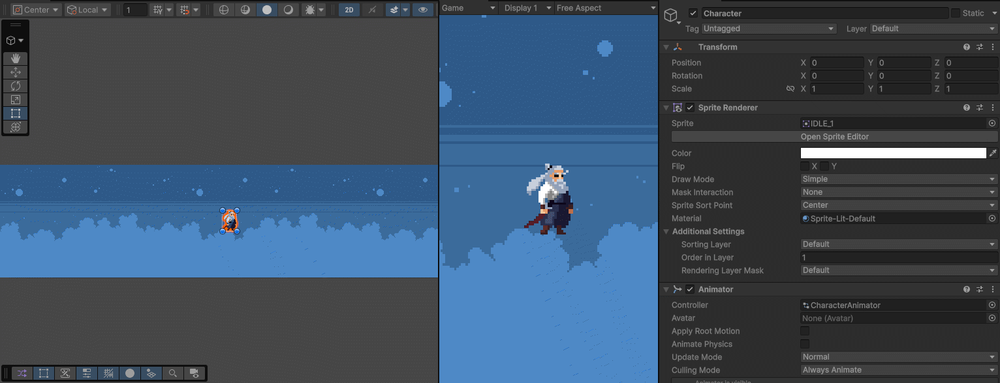
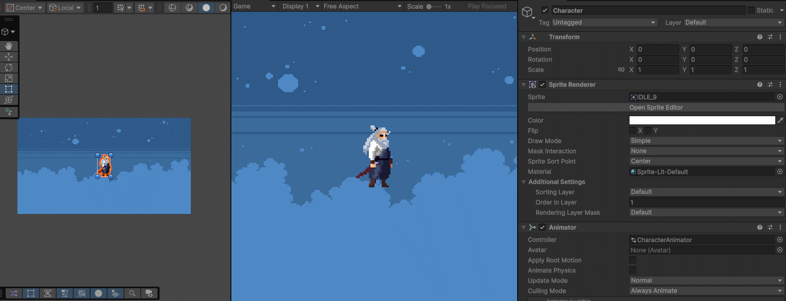
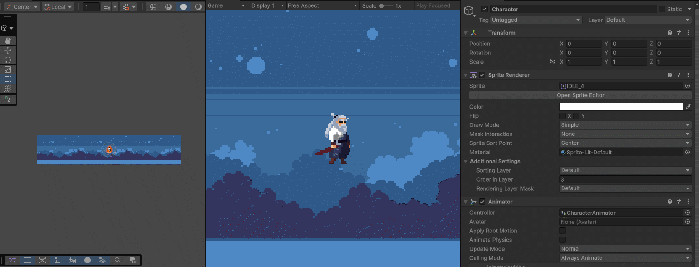
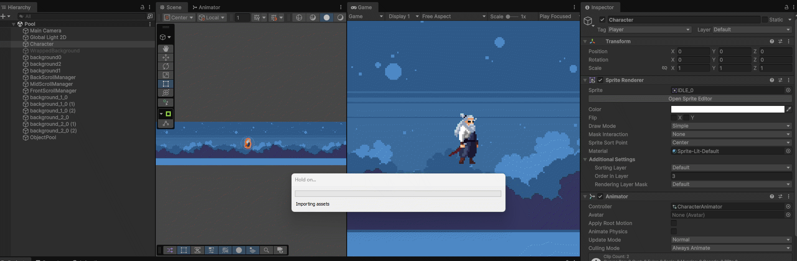

# Técnicas 2D

## Técnicas para lograr el scroll:
1. El scroll se logra repitiendo la imagen, una a continuación de otra. Se debe prevenir que no queden espacios en blanco:
a. La cámara está fija, el fondo se va desplazando en cada frame. Se usan dos fondos. Uno de ellos lo va viendo la cámara en todo momento, el otro está preparado para el momento en que se ha avanzado hasta el punto en el que la vista de la cámara ya no abarcaría el fondo inicial. 
b. La cámara se desplaza a la derecha y el fondo está estático. Existe nuevamente un fondo de reserva que pasa a verse cuando el avance de la cámara sobrepasa el límite. El fondo anterior debe ubicarse a continuación del otro para que esté preparado. 

> Tarea: Aplicar un fondo con scroll a tu escena utilizando la técnica descrita en a.

Para lograr esto, se ha creado un script que gestione el scroll del fondo.
Al comienzo, se obtiene la posición inicial del fondo:

```cs
void Start()
{
    _initialX = _currentBackground.position.x;
}
```

Después, se crea un método público al que, mediante referencia, el personaje se comunica para indicar la dirección:

```cs
public void ScrollBackgrounds(float direction)
{
    // Desplazamiento
    _currentBackground.Translate(-direction * _scrollSpeed * Time.deltaTime, 0, 0);

    // Seguimiento del fondo central
    _leftBackground.position = new Vector2(_currentBackground.position.x - _spriteWidth, _currentBackground.position.y);
    _rightBackground.position = new Vector2(_currentBackground.position.x + _spriteWidth, _currentBackground.position.y);

    // Condiciones de cambio para ambas direcciones
    if (_currentBackground.position.x < _initialX - _spriteWidth)
    {
        _tempBackground = _currentBackground;
        _currentBackground = _rightBackground;
        _rightBackground = _leftBackground;
        _leftBackground = _tempBackground;
        _initialX = _currentBackground.position.x;
    }
    else if (_currentBackground.position.x > _initialX + _spriteWidth)
    {
        _tempBackground = _currentBackground;
        _currentBackground = _leftBackground;
        _leftBackground = _rightBackground;
        _rightBackground = _tempBackground;
        _initialX = _currentBackground.position.x;
    }
}
```

En este caso, en vez de limitar el movimiento del jugador hacia la derecha, se ha propuesto una alternativa donde permite dirigirse en ambas direcciones. Como consecuencia, se han utilizado tres copias del fondo en lugar de dos, para poder gestionar ambos lados. El resultado es el siguiente:



Se puede observar que la posición del Transform del jugador es siempre cero pero el fondo se desplaza y logra el efecto de movimiento.


> Tarea: Aplicar un fondo con scroll a tu escena utilizando la técnica descrita en b.

Para seguir al jugador, se ha introducido una Cinemachine Camera.
Posteriormente, se ha reaprovechado el código anterior para hacer un método que se llame en `Update()`:

```cs
private void CheckCameraDistance()
{
    float cameraX = _camera.transform.position.x;
    if (cameraX > _initialX + _spriteWidth)
    {
        _tempBackground = _currentBackground;
        _currentBackground = _rightBackground;
        _rightBackground = _leftBackground;
        _leftBackground = _tempBackground;

        _initialX = _currentBackground.position.x;
        _rightBackground.position = new Vector2(_initialX + _spriteWidth, _currentBackground.position.y);
    }
    else if (cameraX < _initialX - _spriteWidth)
    {
        _tempBackground = _currentBackground;
        _currentBackground = _leftBackground;
        _leftBackground = _rightBackground;
        _rightBackground = _tempBackground;
        
        _initialX = _currentBackground.position.x;
        _leftBackground.position = new Vector2(_initialX - _spriteWidth, _currentBackground.position.y);
    }
}
```

Tanto en este caso como el anterior se ha optado por no utilizar la mitad del ancho de la cámara sino la posición actual para evitar jittering en los bordes, puesto que al ubicarse tres fondos, en los bordes entre ellos puede actualizarse indebidamente sus ubicaciones.
Como resultado, se observa la misma visualización que antes, pero con el movimiento del jugador:


2. Desplazar el punto a partir del cual se aplica la textura. La parte sobrante se aplica en el espacio vacío.

> Tarea: Aplicar un fondo a tu escena aplicando la técnica del desplazamiento de textura.

Para este caso, se ha creado un material con el shader Unlit/Texture, se ha aplicado a un Quad y se ha seleccionado un nuevo fondo con la propiedad Repeat para la envoltura.

El offset de la textura lo calcula el jugador gracias a su "distancia" recorrida `_textureOffset = _direction * _moveSpeed * Time.deltaTime;`. Tras esto, lo envía al script que se encarga del fondo, llamando a este método:

```cs
public void UpdateBackgroundOffset(float offset)
{
    _offset += offset;

    _renderer.material.mainTextureOffset = new Vector2(_offset, 0);
}
```

Como resultado, se desplaza el fondo, con la cámara fija y con el jugador en la misma posición:



## Efecto Parallax:
> Tarea: Aplicar efecto parallax usando la técnica de scroll en la que se mueve continuamente la posición del fondo.

Para este efecto, se ha reutilizado el código existente de ScrollManager y se han creados dos managers nuevos para cada capa (base, intermedia y frontal). Se han creado tres fondos en cada capa y asignados a cada manager correspondiente. Por el lado del jugador, este almacena las referencias de los tres managers y llama al método que actualiza sus posiciones. El efecto obtenido es un desplazamiento individual de cada capa del parallax, donde al alcanzar la distancia necesaria, el fondo auxiliar se vuelve el principal en cada capa:



> Tarea: Aplicar efecto parallax actualizando el offset de la textura.

Al igual que con el material en singular, actualizado por el jugador, se llama a un método dado el offset calculado según la distancia a recorrer:

```cs
public void UpdateParallaxTexturesOffset(float offset)
{
    for (int i = 0; i < _layers.Length; i++)
    {
        Material m = _layers[i];
        Vector2 offset2D = new Vector2(offset, 0);
        m.SetTextureOffset("_MainTex", m.GetTextureOffset("_MainTex") + offset2D * (i * _speedDifference + _baseSpeed));
    }
}
```

Ajustando las velocidades, se puede obtener mayor diferencia entre las capas. Como resultado, se observa el parallax sin mover al jugador ni utilizando fondos auxiliares:


 
> Tarea: En tu escena 2D crea un prefab que sirva de base para generar un tipo de objetos sobre los que vas a hacer un pooling de objetos que se recolectarán continuamente en tu escena. Cuando un objeto es recolectado debe pasar al pool y dejar de visualizarse. Este objeto estará disponible en el pool. En la escena, siempre que sea posible debe haber una cantidad de objetos que fijes, hasta que el número de objetos que no se han eliminado sea menor que dicha cantidad. Recuerda que para generar los objetos puedes usar el método Instantiate. Los objetos ya creados pueden estar activos o no, para ello usar SetActive. 

Para esta tarea, se ha creado un objeto con un sprite de una bellota. Como quería seguir practicando con el parallax, preparé un script de movimiento para el objeto basado en los delegados de C#. Principalmente, se resume en la línea `_playerController.OnPlayerMove += Move;`, donde la distancia que debería recorrer el jugador, la recorre el objeto en dirección contraria. Con esto, los objetos se pueden mover en un parallax donde el jugador se mantiene quieto. El jugador envía el mensaje con la distancia que está recorriendo y los objetos que lo escuchen se moverán de acorde, sin tener que realizar un acople directo entre el jugador y los objetos en concreto.

Además, añadí colisiones al jugador y los objetos para interactuar al tocarse. En este caso, el objeto vuelve al pool una vez alcanzado.

El pool de objetos consta de una inicialización de todos con su consecuente desactivación:

```cs
void Awake()
{
    _pool = new List<GameObject>();
    for (int i = 0; i < _poolSize; i++)
    {
        GameObject obj = Instantiate(_baseObject);
        obj.GetComponent<ParallaxObject>().pool = this;
        obj.SetActive(false);
        _pool.Add(obj);
    }
}
```

Tras esto, con un método público en el pool se puede solicitar obtener un objeto del mismo para usarse. En este caso, se llama desde el jugador para colocarlo delante suyo:

```cs
public GameObject RequestItem()
{
    if (_pool.Count > 0)
    {
        GameObject obj = _pool[0];
        _pool.RemoveAt(0);
        return obj;
    }

    Debug.Log("No quedan objetos en el pool! Creando uno nuevo!");
    GameObject newObj = Instantiate(_baseObject);
    newObj.GetComponent<ParallaxObject>().pool = this;
    _poolSize++;
    return newObj;
}
```

En caso de que el pool esté vacío, se genera un nuevo objeto y se agranda el máximo. Actualmente el número máximo solo es indicativo, pero se podría emplear para gestionar mejor los recursos.
Aquí no se incluye la activación del objeto por si se desea realizar cualquier cambio previamente. Sin embargo, al devolver el objeto, este se desactiva por seguridad:

```cs
public void ReturnItem(GameObject obj)
{
    obj.SetActive(false);
    _pool.Add(obj);
}
```

Como resultado, los objetos se sacan del pool para aparecer en el juego, una vez se recogen, vuelven al pool:



> Tarea: Revisa tu código de la entrega anterior e indica las mejoras que podrías hacer de cara al rendimiento.

Revisando el proyecto donde utilizamos la cámara Cinemachine y otros proyectos pasados, existen algunas cosas mejorables y otras que estaba haciendo bien:
- Las referencias las obtenía desde el editor, sin utilizar `GetComponent<>()` ni `Find()`, por lo que el rendimiento mejora.
- Las variables que se usen en bucles como `Update()` se declaran externamente para ahorrar recursos y no tener que ubicar nuevas variables idénticas en memoria.
- Antes, utilizaba `collision.tag` en lugar de `collision.CompareTag`, por lo que es menos eficiente.
- El mayor gasto de rendimiento que desconocía es que tanto `Start()` como `Update()` se ejecutan cuando están declaradas, pero no se ejecutan cuando no se declaran, aunque formen parte de los MonoBehaviours. Anteriormente asumía que dejarlos escritos era igual de eficientes, por lo que siempre los tengo colocados. Para mejorar el rendimiento, debería eliminar todas esas funciones vacías de todos los objetos donde no las use.
- Por último, cada vez que quería eliminar un objeto, utilizaba `Destroy()`. Esto se puede mejorar en casos donde volverá a aparecer el mismo objeto, desactivándolo y volviéndolo a activar cuando sea necesario para evitar que el recolector de basura baje el rendimiento.

