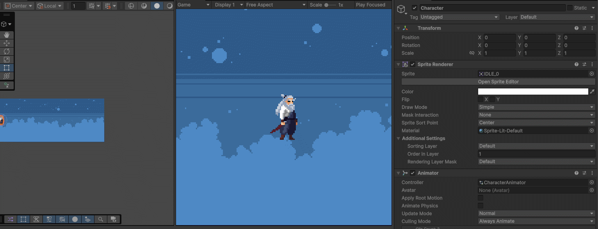

# Técnicas 2D

## Técnicas para lograr el scroll:
1. El scroll se logra repitiendo la imagen, una a continuación de otra. Se debe prevenir que no queden espacios en blanco:
a. La cámara está fija, el fondo se va desplazando en cada frame. Se usan dos fondos. Uno de ellos lo va viendo la cámara en todo momento, el otro está preparado para el momento en que se ha avanzado hasta el punto en el que la vista de la cámara ya no abarcaría el fondo inicial. 
b. La cámara se desplaza a la derecha y el fondo está estático. Existe nuevamente un fondo de reserva que pasa a verse cuando el avance de la cámara sobrepasa el límite. El fondo anterior debe ubicarse a continuación del otro para que esté preparado. 

> Tarea: Aplicar un fondo con scroll a tu escena utilizando la técnica descrita en a.

Para lograr esto, se ha creado un script que gestione el scroll del fondo.
Al comienzo, se obtiene la posición inicial del fondo:

```cs
void Start()
{
    _initialX = _currentBackground.position.x;
}
```

Después, se crea un método público al que, mediante referencia, el personaje se comunica para indicar la dirección:

```cs
public void ScrollBackgrounds(float direction)
{
    // Desplazamiento
    _currentBackground.Translate(-direction * _scrollSpeed * Time.deltaTime, 0, 0);

    // Seguimiento del fondo central
    _leftBackground.position = new Vector2(_currentBackground.position.x - _spriteWidth, _currentBackground.position.y);
    _rightBackground.position = new Vector2(_currentBackground.position.x + _spriteWidth, _currentBackground.position.y);

    // Condiciones de cambio para ambas direcciones
    if (_currentBackground.position.x < _initialX - _spriteWidth)
    {
        _tempBackground = _currentBackground;
        _currentBackground = _rightBackground;
        _rightBackground = _leftBackground;
        _leftBackground = _tempBackground;
        _initialX = _currentBackground.position.x;
    }
    else if (_currentBackground.position.x > _initialX + _spriteWidth)
    {
        _tempBackground = _currentBackground;
        _currentBackground = _leftBackground;
        _leftBackground = _rightBackground;
        _rightBackground = _tempBackground;
        _initialX = _currentBackground.position.x;
    }
}
```

En este caso, en vez de limitar el movimiento del jugador hacia la derecha, se ha propuesto una alternativa donde permite dirigirse en ambas direcciones. Como consecuencia, se han utilizado tres copias del fondo en lugar de dos, para poder gestionar ambos lados. El resultado es el siguiente:


Se puede observar que la posición del Transform del jugador es siempre cero pero el fondo se desplaza y logra el efecto de movimiento.


> Tarea: Aplicar un fondo con scroll a tu escena utilizando la técnica descrita en b.

Para seguir al jugador, se ha introducido una Cinemachine Camera.
Posteriormente, se ha reaprovechado el código anterior para hacer un método que se llame en `Update()`:
```cs
private void CheckCameraDistance()
{
    float cameraX = _camera.transform.position.x;
    if (cameraX > _initialX + _spriteWidth)
    {
        _tempBackground = _currentBackground;
        _currentBackground = _rightBackground;
        _rightBackground = _leftBackground;
        _leftBackground = _tempBackground;

        _initialX = _currentBackground.position.x;
        _rightBackground.position = new Vector2(_initialX + _spriteWidth, _currentBackground.position.y);
    }
    else if (cameraX < _initialX - _spriteWidth)
    {
        _tempBackground = _currentBackground;
        _currentBackground = _leftBackground;
        _leftBackground = _rightBackground;
        _rightBackground = _tempBackground;
        
        _initialX = _currentBackground.position.x;
        _leftBackground.position = new Vector2(_initialX - _spriteWidth, _currentBackground.position.y);
    }
}
```

Tanto en este caso como el anterior se ha optado por no utilizar la mitad del ancho de la cámara sino la posición actual para evitar jittering en los bordes, puesto que al ubicarse tres fondos, en los bordes entre ellos puede actualizarse indebidamente sus ubicaciones.
Como resultado, se observa la misma visualización que antes, pero con el movimiento del jugador:




2. Desplazar el punto a partir del cual se aplica la textura. La parte sobrante se aplica en el espacio vacío.

> Tarea: Aplicar un fondo a tu escena aplicando la técnica del desplazamiento de textura.

## Efecto Parallax:
> Tarea: Aplicar efecto parallax usando la técnica de scroll en la que se mueve continuamente la posición del fondo.

> Tarea: Aplicar efecto parallax actualizando el offset de la textura.
 
> Tarea: En tu escena 2D crea un prefab que sirva de base para generar un tipo de objetos sobre los que vas a hacer un pooling de objetos que se recolectarán continuamente en tu escena. Cuando un objeto es recolectado debe pasar al pool y dejar de visualizarse. Este objeto estará disponible en el pool. En la escena, siempre que sea posible debe haber una cantidad de objetos que fijes, hasta que el número de objetos que no se han eliminado sea menor que dicha cantidad. Recuerda que para generar los objetos puedes usar el método Instantiate. Los objetos ya creados pueden estar activos o no, para ello usar SetActive. 

> Tarea: Revisa tu código de la entrega anterior e indica las mejoras que podrías hacer de cara al rendimiento.
